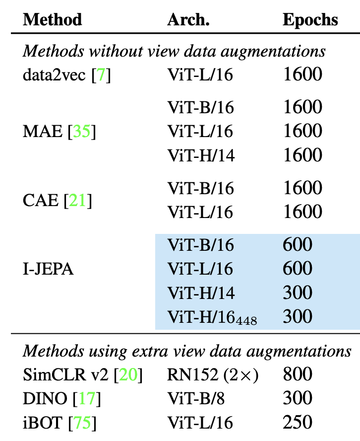
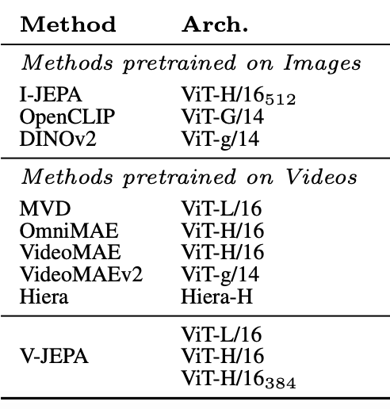
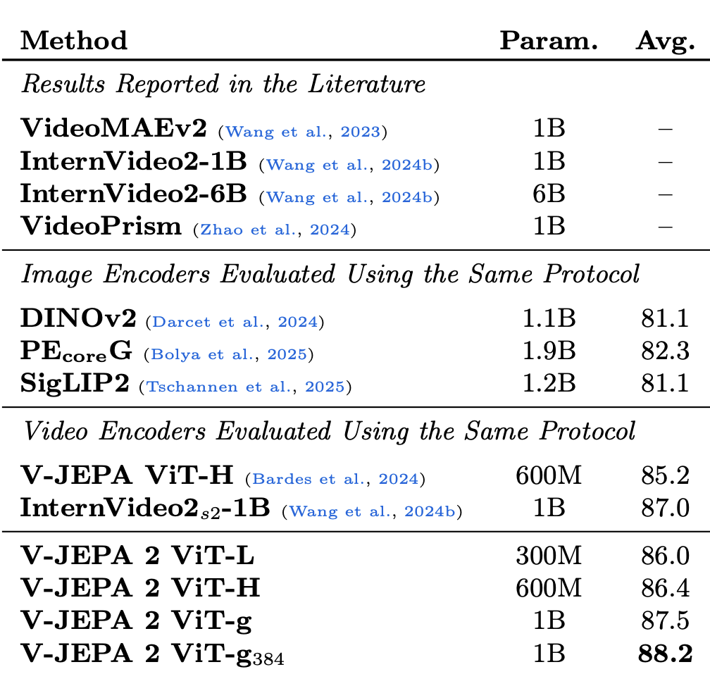
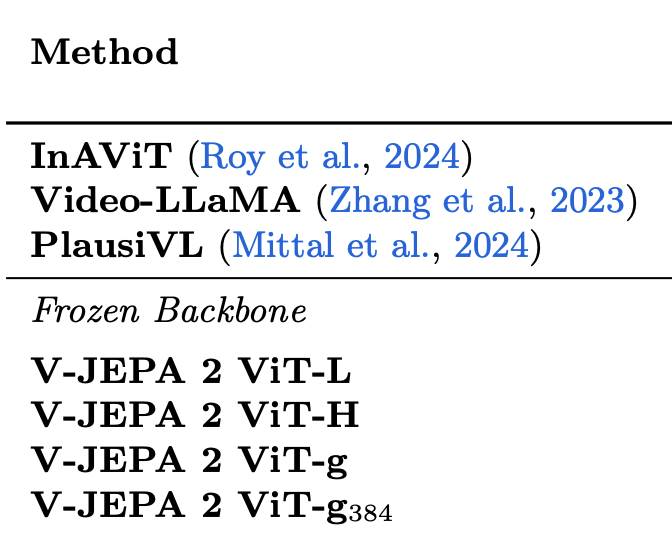
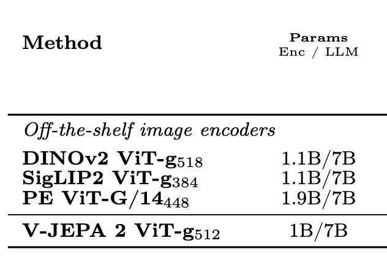
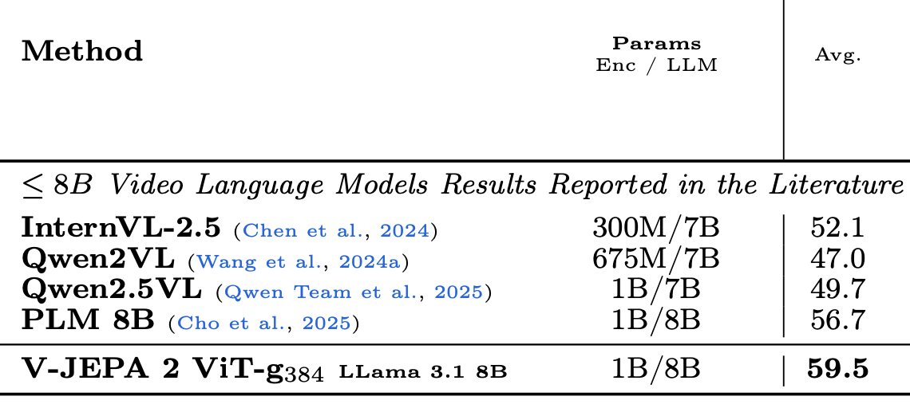

# RIND-JEPA Comparative Experiments — Vision Model

# Table of Contents

- [1. 明确学习目标](#1-明确学习目标)
- [2. Literature Review](#2-literature-review)
  - [Paper 1 · I-JEPA · CVPR 2023](#paper-1--i-jepa--cvpr-2023)
  - [Paper 2 · V-JEPA · TMLR 2024](#paper-2--v-jepa--tmlr-2024)
  - [Paper 3 · V-JEPA 2 · 2025](#paper-3--v-jepa-2--2025)
- [3. RIND 对比算法选择](#3-rind-对比算法选择)
  - [3.1 在 RIND 自身 backbone 上换 objective](#31-在-rind-自身-backbone-上换-objective)
  - [3.2 Frozen encoder probing](#32-frozen-encoder-probing)
  - [3.3 End-to-end systems](#33-end-to-end-systems)
- [4. 保证实验公平](#4-保证实验公平)

---

## 1. 明确学习目标

- 输入包含几何场景及其他相关条件，目标是预测空间中的 visibility/shadow field（**dense spacial prediction**）
- 任务的重要特征是非局部依赖（**nonlocality**）和由于遮挡产生的不连续变化（**regime discontinuity**）
- 对比试验需要证明 RIND-JEPA 在有限标签、未知几何、长程遮挡和计算成本方面具有明确优势

## 2. Literature Review

### Paper 1 · I-JEPA · CVPR 2023

[Self-Supervised Learning from Images with a Joint-Embedding Predictive Architecture](https://openaccess.thecvf.com/content/CVPR2023/html/Assran_Self-Supervised_Learning_From_Images_With_a_Joint-Embedding_Predictive_Architecture_CVPR_2023_paper.html)

**1.1｜学习目标**：

> 不依赖 pixel reconstruction，也不依赖 handcrafted data augmentations，只通过图像中可见的 context blocks 预测 masked target blocks 的 **latent feature representations**，是否可以学习到高质量、语义性强、计算效率高的视觉表示？

**1.2｜Baseline selection：**

I-JEPA 的 baseline 围绕 **“what is predicted”**（pixels or representations）以及 **“how supervision is constructed”**（masked context or augmented views）展开。
| Baseline family | Representative methods | Selection rationale |
| --------------------------------------------------------- | ---------------------- | ----------------------------------------------------------------------------------------------------------------------- |
| Masked pixel reconstruction | **MAE** | 比较 latent prediction 与 pixel-level reconstruction，检验是否必须恢复低层视觉细节 |
| Masked feature prediction / representation reconstruction | **data2vec, CAE** | 与其他 masked representation learning 设计比较，检验 I-JEPA 的目标、masking 与训练框架是否具有竞争力 |
| View-invariance / self-distillation | **DINO, iBOT, MSN** | 与依赖多视图数据增强或 self-distillation 的强视觉表征方法比较，检验不使用额外 handcrafted view augmentations 的可行性 |

**1.3｜Model design：**

- 主要共享的是encoder backbone
- 无法共享backbone的model：
  | Baseline | 论文 Backbone | 为什么不同 | 如何比较 |
  | --------- | ------------- | -------------------------------- | ---------------------------------- |
  | DINO | ViT-B/8 | 使用了不同 patch size 的原始配置 | 共同的 ImageNet linear evaluation |
  | SimCLR v2 | RN152 (2×) | ResNet CNN，而非 ViT 统一的 | classification benchmark 和 metric |

**1.4｜Evaluation protocol：**

- 论文使用 **linear probing、transfer learning** 以及其他下游任务评价冻结/迁移的 representation，并比较 **training efficiency**。

- 作者将使用额外 view augmentation 与不使用此类 augmentation 的方法分组报告，以避免忽略其预训练假设差异。

- 论文尽量通过**共同的下游评估任务**提供公平竞争，但不同方法的预训练数据、训练轮数、模型尺寸和增强策略并不完全一致。因此，跨论文结果更适合解释为 **method/system performance comparison**，不能全部解释为单一 loss function 的严格因果优势。

**1.5｜结论：**

- 实验的主要支持性结论是：I-JEPA 通过 latent feature prediction 能获得具有竞争力的 semantic representations，并具有较好的扩展性和训练效率；但这**不意味着在所有 downstream benchmarks 上都优于所有 baseline**。

- 对于新的 JEPA-based 方法，应该同时选择与其 **学习目标最相近** 的方法和来自 **不同 self-supervised paradigms** 的强竞争者。

---

### Paper 2 · V-JEPA · TMLR 2024

[Revisiting Feature Prediction for Learning Visual Representations from Video](https://arxiv.org/abs/2404.08471)

**2.1｜学习目标**：

> 将 JEPA 扩展到video-based spatiotemporal representation learning。从视频中学习可以迁移到**appearance understanding**和**motion understanding**任务的**通用表征**，而不依赖像素重建。

**2.2｜Baseline selection：**

| Baseline family                              | Representative methods                       | Selection rationale                                                                                                                                   |
| -------------------------------------------- | -------------------------------------------- | ----------------------------------------------------------------------------------------------------------------------------------------------------- |
| Video masked autoencoding / pixel prediction | **VideoMAE, VideoMAEv2, OmniMAE, Hiera**     | 最直接检验 **feature prediction vs. pixel reconstruction**，尤其是冻结表示质量和训练成本                                                              |
| Other video representation learning          | **MVD** and other competitive video encoders | 检验 V-JEPA 在成熟 video representation learning 方法中的竞争力（MVD 同时涉及特征蒸馏与像素/特征相关训练设计，不宜简单概括成纯 pixel reconstruction） |
| Strong image-pretrained encoders             | **I-JEPA, DINOv2, OpenCLIP**                 | 比较 **video-specific pretraining vs. image representation learning**；分析 motion-heavy 和 appearance-heavy tasks 的差别                             |

其中，**VideoMAE / VideoMAEv2** 是最直接的 methodological competitors，因为它们同样通过 **masked video modeling** 学习，但主要依赖 pixel reconstruction。DINOv2、OpenCLIP 等则帮助判定“视频学习是否比强 **image encoders** 更有利于 motion understanding”。

**2.3｜Model design：**

- 论文重点比较了 V-JEPA vs. VideoMAE：
  <table>
    <tr>
      <th>Component</th>
      <th>V-JEPA ViT-L/16</th>
      <th>VideoMAE ViT-L/16</th>
    </tr>
    <tr>
      <td>Encoder</td>
      <td colspan="2" align="center">Video ViT</td>
    </tr>
    <tr>
      <td>Backbone specification</td>
      <td colspan="2" align="center">ViT-L/16</td>
    </tr>
    <tr>
      <td>Learning objective</td>
      <td>Latent feature prediction</td>
      <td>Pixel reconstruction</td>
    </tr>
    <tr>
      <td>Training architecture</td>
      <td>Context/target encoder + predictor</td>
      <td>Encoder + pixel decoder</td>
    </tr>
    <tr>
      <td>Pretraining data</td>
      <td>VideoMix2M 或 K400 配置</td>
      <td>K400 等原始配置</td>
    </tr>
    <tr>
      <td>Pretraining budget</td>
      <td>V-JEPA 自身训练配置</td>
      <td>VideoMAE 原始配置</td>
    </tr>
    <tr>
      <td>Downstream encoder</td>
      <td colspan="2" align="center">Frozen</td>
    </tr>
    <tr>
      <td>Probe</td>
      <td colspan="2"align="center" >Attentive probe</td>
    </tr>
  </table>

- 无法共享backbone的model：
  |Baseline |Architecture |如何处理|
  |--|--|--|
  |Hiera |Hierarchical Transformer |保留原生架构，统一 benchmark|
  |VideoMAEv2 |ViT-g/14 |统一下游 evaluation|
  |DINOv2 |ViT-g/14 |Frozen evaluation|
  |OpenCLIP |ViT-G/14 |Frozen evaluation|

- V-JEPA 论文甚至专门比较了同为 ViT-L/16 的 V-JEPA 和 VideoMAE 使用 **linear probe** 与 **attentive probe** 的表现，说明不同 probe 对最终评价有显著影响。

**2.4｜Evaluation protocol：**

- V-JEPA 特别强调 **frozen encoder evaluation**：预训练 backbone 保持冻结，在不同下游任务上训练相应的 probe。论文也考察 **attentive probing**、少标注样本下的 label efficiency，以及部分任务上的 **end-to-end fine-tuning**。

  > → 验证 **self-supervised pretraining** 所学习到的 representations 本身是否足够有用。

- V-JEPA 还专门研究了 **low-shot frozen evaluation**：只给 probe 5%、10%、50% 的标注数据，并用多个随机划分评价robutness。

  > → 如果只有少量 labels，哪个模型预训练得到的 features 更容易被利用？

- 其公平性设计的关键是尽量统一 **downstream probe and evaluation protocol**，同时报告 backbone、预训练数据与输入分辨率等差异。论文的 supplementary/appendix 还专门比较 linear probe 与 attentive probe，以说明 probe architecture 本身会影响测得的 representation quality。

**2.5｜结论：**

- V-JEPA 表明，**latent feature prediction 可以独立地学到强视频表征**。相对于以 pixel prediction 为代表的视频预训练方法，它在 frozen evaluation、部分 motion-centric tasks 以及 label efficiency 方面展现优势；在 full fine-tuning 设置下，优势则不一定保持为同样的幅度。

- 特别重要的是，论文并未将全部结果压缩成一个单一平均准确率，而是通过 **motion vs. appearance、frozen vs. fine-tuned、accuracy vs. training cost、full-label vs. low-label** 等多维度展示不同方法的能力边界。

- 如果研究主要 claim 是 representation quality，那么 frozen evaluation 是重要证据；但若最终目标是 supervised dense prediction，还应当单独纳入 end-to-end supervised baselines，不能以 frozen-probe comparison 替代任务层面的竞争性评估。

---

### Paper 3 · V-JEPA 2 · 2025

[V-JEPA 2: Self-Supervised Video Models Enable Understanding, Prediction and Planning](https://arxiv.org/abs/2506.09985)

**3.1｜学习目标**：

> 将 latent predictive representation learning 扩展到更大规模的视频数据，不只是学习优质视频特征，还包括：
>
> - 通过 self-supervised pretraining 学习可迁移的 **motion and appearance representation**
> - 从观察到的视频 context 预测 **future** 动作或事件相关信息
> - 在额外少量机器人交互数据 post-training 后，构建 action-conditioned **latent world model**（V-JEPA 2-AC），用于 robot control

**3.2｜Baseline selection：**

| Comparison objective                      | Representative baselines                                                                          | Selection rationale                                                                                                                                                                                     |
| ----------------------------------------- | ------------------------------------------------------------------------------------------------- | ------------------------------------------------------------------------------------------------------------------------------------------------------------------------------------------------------- |
| Comparison against previous generation    | **V-JEPA**                                                                                        | 衡量新一代模型在视觉理解和视频预测任务中的总体改进                                                                                                                                                      |
| Image vs. video representations           | **DINOv2, SigLIP2, Perception Encoder**                                                           | 比较 image SSL、image-text pretraining 与 video SSL 所学 representation 的质量，尤其关注 temporal information 是否带来额外收益                                                                          |
| Strong video foundation encoders          | **InternVideo2**, plus reported results from **VideoMAEv2, VideoPrism**                           | 检验大规模视频预训练竞争力；区分统一 probe 下复现的结果与文献结果                                                                                                                                       |
| Future action anticipation                | reported results from **InAViT, Video-LLaMA, PlausiVL**                                           | 证明 learned representations 能否支持 future-action prediction，而不只是当前帧分类                                                                                                                      |
| Off-the-shelf image encoders for Video QA | **DINOv2, SigLIP2, PE**                                                                           | 在统一 LLM、alignment dataset 和 training pipeline 下，隔离不同 visual encoders 对 Video QA / temporal reasoning 的贡献，检验不依赖 language-supervised pretraining 的视频 encoder 是否也能有效接入 LLM |
| End-to-end video QA                       | reported result from **InternVL-2.5、Qwen2VL、Qwen2.5VL、PerceptionLM**（和V-JEPA2接入LLM后对比） | 比较完整 MLLM systems 的最终能力，验证 V-JEPA 2 经过大规模 vision-language alignment 后能否达到 state-of-the-art 水平                                                                                   |
| Robotic planning                          | **Octo, Cosmos**                                                                                  | 评价 learned world model 在实际机器人交互任务中的效果                                                                                                                                                   |

**3.3｜Model design：**

所有模型的 backbone 都不一样，作者主要采用三种对比方法：
| Evaluation strategy | Backbone treatment | Downstream training |
|---|---|---|
| Frozen encoder + common probe | 保留各 pretrained backbone，冻结参数 | 每个模型分别训练相同架构的 probe |
| Controlled MLLM adaptation\*\* | 替换不同 visual encoders，统一 LLM backbone | 训练 projector / pooler 和 LLM，vision encoder 可冻结或 fine-tune |
| System-level comparison | 保留各模型完整 architecture | 使用已有报告结果，或按各自方法 fine-tune 和 evaluate |

| Representation quality                        | Action anticipation                           | Off-the-shelf image encoders                  | End-to-end VidQA performance                  |
| --------------------------------------------- | --------------------------------------------- | --------------------------------------------- | --------------------------------------------- |
|  |  |  |  |

**3.4｜Evaluation protocol：**

- 这里最值得借鉴的是 **baseline selection follows the evaluation claim**。不同任务并没有强迫使用完全相同的一组竞争方法：
  - representation benchmarks 对比视觉 encoder；
  - anticipation benchmarks 对比预测模型；
  - planning benchmarks 则对比控制/规划方法。

- 那么所有模型的 backbone 都不一样，怎么保证实验公平？

  > → 统一学习一个 **attentive probe** on top of the **frozen encoder**

- **system-level comparison**: 论文明确承认，不同 baseline 使用了不同的预训练数据，不能当作严格控制条件的因果比较，不能直接把差异全部归因于 JEPA objective。

- 论文还将 **image encoders** 与 **video encoders** 分组列出，并明确区分：
  1. **Models evaluated using the same downstream protocol**：例如 DINOv2、SigLIP2、Perception Encoder、V-JEPA、InternVideo2 的部分版本，以及 V-JEPA 2。
  2. **Results reported in prior literature**：如部分 VideoMAEv2、InternVideo2 和 VideoPrism 结果；这些不应被误写为全部重新训练并统一评估。

**3.5｜结论：**

- V-JEPA 2 的比较支持更大规模 self-supervised video feature learning 在 **motion understanding、action anticipation** 等任务上的竞争力；结合额外 post-training，还能构建用于规划的 action-conditioned latent model。

- 与 I-JEPA、V-JEPA 相比，V-JEPA 2 更明显地采用了 **multi-task, claim-specific evaluation**：针对理解、预测和控制分别选择更贴近任务的 baseline，而不是试图用单一算法表证明整体优越性。

- 公平性不等于强制使用完全相同的内部架构，而是尽量统一任务和可控变量，并透明报告不可控差异。

## 3. RIND 对比算法选择

| Evaluation strategy                  | Candidate models                               | What changes                                    | Primary scientific claim                                                                                               |
| ------------------------------------ | ---------------------------------------------- | ----------------------------------------------- | ---------------------------------------------------------------------------------------------------------------------- |
| 在 RIND 自身 backbone 上换 objective | Direct supervised, Geometry-MAE, Geometry-JEPA | Learning objective, teacher target, pretraining | Is response-targeted latent alignment more effective than direct supervision or geometry-only representation learning? |
| Frozen encoder probing               | DINOv3, V-JEPA 2, Sonata (PTv3), SAM 2 Hiera   | Pretrained encoder                              | Which learned representations is most effective for RIND shadow prediction?                                            |
| End-to-end systems                   | Conditional U-Net, GINO, SegMAN, V-JEPA2       | Full modeling architecture                      | Is RIND competitive with modern state-of-art dense prediction and neural operator systems?                             |

### 3.1 在 RIND 自身 backbone 上换 objective

| Method                 | Pretraining / learning objective  | Pretraining target                                                    |
| ---------------------- | --------------------------------- | --------------------------------------------------------------------- |
| Direct Supervised RIND | Supervised boundary prediction    | 无此阶段                                                              |
| Geometry-MAE RIND      | Masked geometry reconstruction    | Masked geometry features，主要是高度值和有效性 (不访问 shadow labels) |
| Geometry-JEPA RIND     | Masked geometry latent prediction | Teacher-target-encoded masked geometry (不访问 shadow labels)         |

- 一定要防止几何信息泄漏，遮罩必须同时作用于所有输入
- CNN 上的 MAE 容易漏信息，因为ViT 可以直接丢掉被遮的 patch，但是CNN的卷积和pooling会把遮罩边界的信息带进去。要在pooling前就替换为 mask token，并加一个 mask 通道，或者采用 SparK、ConvNeXt V2 那样的稀疏卷积
- MAE 和纯几何 JEPA 不需要标签，理论上可以用更多只有几何的 tile。主实验建议和 RIND 用同一批 tile，额外无标签数据的版本单独报告

### 3.2 Frozen encoder probing

| Candidate model      | Input modality | Pretraining objective                      | Comparative question                                                         |
| -------------------- | -------------- | ------------------------------------------ | ---------------------------------------------------------------------------- |
| DINOv3 (2025)        | 2D image       | Image self-supervision                     | 通用 image SSL representation 是否足以表示建筑结构？                         |
| Sonata (PTv3) (2025) | 3D point cloud | 3D self-distillation                       | 直接使用 3D geometric representations 是否比 2D representations 更有优势？   |
| SAM 2 Hiera (2024)   | 2D image       | MAE initialization + segmentation training | Segmentation-oriented spatial features 是否改善 shadow boundary prediction？ |
| V-JEPA 2.1 (2026)    | Image/video    | Dense JEPA-style feature prediction        | Video predictive representations 是否适合迁移到条件 shadow prediction？      |

- 输入要适配：
  - 选 3 个通道，归一化后当伪 RGB；
  - 把 patch embedding 换成可学习的 8 通道版本。这时 encoder 不再完全冻结，要单独标明；
  - 不用真实太阳方向渲染 hillshade，否则太阳信息会进入 encoder

- 太阳条件放在 probe 里，不放进 encoder，frozen encoder 只看几何。照 V-JEPA 2 比较 linear 和 attentive probe 的做法，这里也可以分两档 probe 汇报：
  - Local probe：逐像素 MLP，用 FiLM 注入太阳向量。它检验的是 frozen feature 本身有没有编码各方向的遮挡信息。这是对 "nonlocal representation" 最干净的测试，因为 encoder 编码时不知道太阳在哪，feature 要对任意太阳方向都有用，只能把各方位的遮挡信息都编进去。

  - Sun-conditioned attentive probe：query 是接收点 embedding 加上太阳 embedding，对整张 feature map 做 cross-attention。这一档允许 probe 自己去做 nonlocal 聚合。

- 保证相同空间范围要（RIND 通过 mesh 检索能看到 horizon 以内的遮挡物，而一般图像模型只看到一个 tile。可以选择给所有模型同样的多尺度栅格栈（tile + 400 m + 1600 m 降采样）

- 不确定是否需要统一分辨率，但最终输出必须在原 512×512 网格上

### 3.3 End-to-end systems

| Candidate methods        | Architectural feature                                        | Comparative question                                                                                                                                                      |
| ------------------------ | ------------------------------------------------------------ | ------------------------------------------------------------------------------------------------------------------------------------------------------------------------- |
| Conditional U-net (2019) | Multi-scale dense encoder–decoder + skip-connection          | 不使用 global attention，经典 dense prediction architecture和局部细节恢复，是否就足以预测 RIND field？                                                                    |
| SegMAN (2025)            | State-space modeling + local attention + multi-scale decoder | 如果使用现代 supervised dense prediction architecture，同时整合 local details、multi-scale features 和 long-range spatial dependencies，是否就足以准确预测 shadow field？ |
| GINO (2023)              | Graph neural operator + FNO                                  | 如果使用专门为复杂几何和物理场设计的 neural operator，是否就能有效学习 geometry-to-shadow mapping，而不需要 RIND 的 geometry-guided latent predictive framework？         |
| vanilla V-JEPA2 (2026)   | Latent predictive learning                                   | RIND 的提升是否来自一般 JEPA predictive objective，还是来自针对 nonlocality / discontinuity 的特殊设计？                                                                  |

## 4. 保证实验公平

- 所有模型共用同一套下游任务、数据划分、输出格式和评分器。
  |项目 |要求|
  |--|---|
  |输入信息 |相同的 8 通道几何场、接收点 XYZ、太阳向量；模型可见的几何范围一致。按条件 A（只有栅格）和条件 B（栅格 + 射线候选）分组|
  |Dataset| 相同的 train/val/test、manifest、family 划分、clip 采样种子；主实验使用相同的 21×21×16 标签范围，unknown 不算作阴影|
  |模型输出 |原网格上的 float32 边界分数 d，以及 p = sigmoid(d/τ)；状态阈值统一为 d = 0|
  |校准 |τ 在相同的 calibration family 上校准，不能用 VAL
  |下游训练| 除单独声明的 native-best 组外，下游任务都用同一个 boundary_loss，权重相同|
  |评分| 相同的 scorer、容差、分桶和支持规则
- 尽量匹配，并全部报告

  | 项目     | 做法                                                                   |
  | -------- | ---------------------------------------------------------------------- |
  | 训练预算 | 总更新数相同；同时报告 GPU-hours                                       |
  | 调参     | 相同的试验次数和搜索范围，只调学习率和 weight decay                    |
  | 模型规模 | End-to-end 模型优先选相近规模的版本；frozen encoder 无法匹配时如实列出 |
  | 资源上限 | 相同的显存额度。超限时所有模型按同样方式降配，并写明                   |
  | 标签账本 | 分别记录总解码标签、直接算 loss 的标签和 teacher 读取的标签            |

- 允许不同，但必须明确报告
  - backbone 和 decoder 架构、预训练目标和数据、masking 策略、模型规模、输入通道适配方式、内部输出分辨率，以及 RIND 的三阶段训练流程。

- 评价指标
  |评价维度 |主要指标 |次要指标|
  |---|---|---|
  |整体预测 |全轨迹**Brier** |Sun/Shadow IoU、balanced accuracy、ECE|
  |Regime discontinuity（空间） |0.195 m **boundary F1**| 0.5 m 和 1 m F1、0.5 m band 内距离 MAE 和 p95、漏检和虚假轮廓数|
  |Regime discontinuity（时间）| Endpoint **switch F1**| 方向错误数、变化点和稳态点的 Brier、hold-initial skill、采样事件 run 的 precision/recall|
  |Nonlocality |按遮挡物距离分桶的 Brier 和 shadow recall |低太阳角（0–10°）分组|
  |有限标签| 各标签比例下的 Brier 和 0.195 m F1 曲线 |与 100% 标签相比的下降幅度|
  |未知几何|Holdout 上的主要指标 |与训练域相比的下降幅度|
  |计算成本 |整个 tile、16 帧的**推理延迟**，相对 ray casting 的倍数 |单 query 延迟、峰值显存、参数量、训练 GPU-hours、预处理时间（含 BVH 构建）|
  |覆盖率 |拒绝预测的已知点数和比例 |Unknown 点数|
  - **遮挡物距离分桶**： 用同一 mesh 的 ray casting 算出第一个遮挡物的距离，暂定 <25 m、25–100 m、100–400 m、>400 m，正式分桶在看模型结果前按数据分布固定。受光点没有遮挡物，所以这一分层只评估阴影点；另外单独报告误报，防止模型靠多预测阴影得分。
